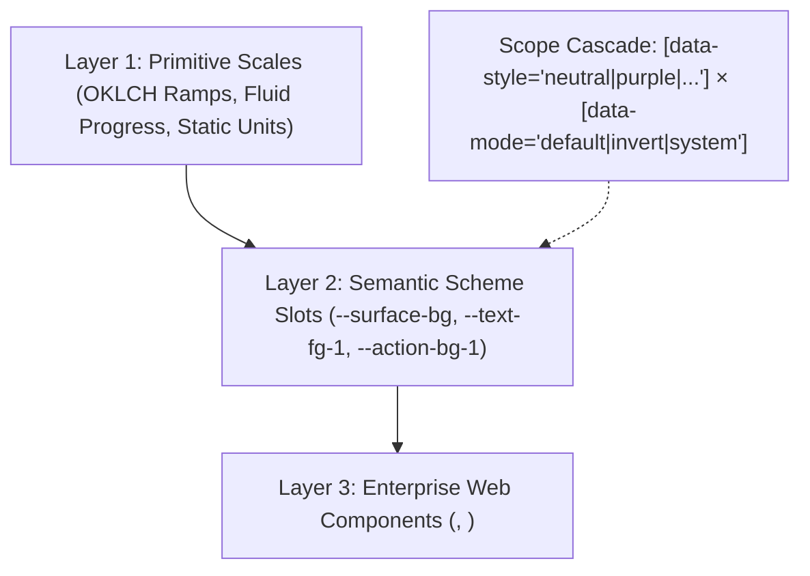

# AHHA Design Decisions, Architecture & Principles

This document records the foundational architectural decisions, visual principles, and component engineering standards established for the AHHA Design System and its codified component library (`@andiihei/ahha`).

---

## 1. Architectural Overview & System Layers

The AHHA Design System is built upon a deterministic three-tier hierarchy designed to keep components completely theme-, brand-, and polarity-agnostic:

### Layer 1: Primitive Scale Ramps
- **Color Families**: 6 distinct OKLCH families (`neutral`, `purple`, `green`, `red`, `yellow`, `blue`) across 11 discrete luminance steps (`1000..25`, omitting steps 400 and 600).
- **Fluid & Static Spacing**:
  - **Fluid Rhythm (`--space-10` to `--space-500`)**: Governed by the Utopia fluid interpolation engine (`progress()` / `@supports tan(atan2())`) scaling from 360px viewport @ 18px base up to 1240px viewport @ 20px base. Reserved exclusively for macro-layouts (page containers, sections, hero blocks).
  - **Static Rhythm (`--space-static-10` to `--space-static-500`)**: Anchored on a fixed 20px base. Reserved for micro-component internals (paddings, gaps, icons, border offsets) to prevent layout distortion on resizing.
- **Concentric Geometry (`radius.css`)**:
  - Inner corner radii follow the geometric law: $R_{inner} = \max(0, R_{outer} - \text{inset})$, preventing awkward gaps in nested boundaries.
- **State Layers (`opacity.css` & `motion.css`)**:
  - Hover states apply an ink layer at `--opacity-10` (10%).
  - Active/pressed states apply an ink layer at `--opacity-15` (15%).
  - Disabled states render at `--opacity-40` (40%) with pointer events suppressed.
  - Micro-interactions use `--duration-50` / `--ease-in-out`; layout shifts use `--duration-100` / `--ease-out`.

### Layer 2: Semantic Scheme Slots
- All UI elements bind to functional slot contracts rather than direct primitive tokens:
  - **Surfaces**: `--surface-bg`, `--surface-bg-1`, `--surface-border`
  - **Text / Ink**: `--text-fg-1` (high-emphasis headline/current ink), `--text-fg-2` (supporting ink)
  - **Actions**: `--action-bg-1`, `--action-fg-1`, `--action-border`
  - **Brand**: `--brand-ink`, `--brand-line`, `--brand-faint`
- Components never hardcode hex, rgb, or specific color family ramps. Theme flipping is achieved simply by toggling `[data-style]` and `[data-mode]` on any ancestor element.

---

## 2. Accessibility & Perceptual Contrast: APCA Standard

A conscious design decision was made regarding color contrast evaluation:

### Decision: APCA (Advanced Perceptual Contrast Algorithm) over WCAG 2.x AA
- **WCAG 2.x Math Limitations**:
  - Standard WCAG 2.x relative luminance (4.5:1 / 3:1) uses a simplified flat mathematical ratio that does not account for modern displays, spatial frequency, font weight, or polarity effects (light-on-dark vs dark-on-light).
  - Automated tools (e.g. axe) frequently flag subtle secondary text or tinted backgrounds as violations despite high real-world legibility under modern perceptual models.
- **System Policy**:
  - The AHHA Design System evaluates readability using the **APCA (WCAG 3.0 draft)** perceptual model.
  - Page links and supporting elements in navigation use `--color-300` / `--neutral-300` on light mode (`--page-dim`) and `--color-500` / `--neutral-500` on dark mode, ensuring visual hierarchy where the active page link (`--text-fg-1` with underline) stands out distinctly without sacrificing reading comfort.
  - Automated WCAG 2.x contrast warnings on secondary link states are intentionally exempted under this design standard.

---

## 3. Responsive Breakpoints & Viewport Boundaries

The AHHA Navigation Menu (`<ads-nav-menu>`) defines three distinct responsive tiers governed by container queries with viewport fallbacks:

| Tier Name | Code Variant | Width Range | Layout Behavior |
| :--- | :--- | :--- | :--- |
| **Extra Compact (Mobile)** | `xCompact` | **380px – 574px** | Brand logo + Tabler glyph burger (`menu-3`) with expandable vertical drawer and mobile segmented mode switcher. |
| **Compact (Tablet)** | `compact` | **574px – 896px** | Two-row layout: Full brand logo on Row 1 (safe space protected), page links and desktop Mode Switcher distributed across Row 2. |
| **Full (Desktop)** | `full` | **896px – 1400px+** | Single-row horizontal layout: Brand logo on the left, cluster with page links and Selector Button on the right. |

### Minimum Supported Viewport Hard Floor: 380px
- The system establishes **380px** as the absolute minimum supported viewport width.
- Sub-380px viewports (e.g. legacy 320px feature phones) are outside the design system target matrix.
- In Storybook interactive specimens, container sliders and wrapper elements enforce explicit `min-width` and `max-width` hard stops matching these exact thresholds.

---

## 4. Logo & Safe Space Protection Principles

The ANDII HEI logotype has specific preservation rules:

1. **Duotone Treatment**:
   - `ANDII` renders with `--brand-ink` (primary high-contrast ink).
   - `HEI` renders with `--brand-faint` (subtle secondary tint), preserving the mark's original typographic rhythm across both default and invert modes.
2. **Safe Space Isolation**:
   - At no point should page links or action controls crowd or clip into the brand logo.
   - When viewport/container width drops below **896px**, the layout immediately breaks into two dedicated rows (`Compact`) rather than wrapping arbitrarily into broken horizontal clusters.
   - When container width drops below **574px**, links collapse into the off-canvas drawer (`xCompact`).

---

## 5. Web Component Authoring Standards

All enterprise custom elements in `src/components/` adhere to the following codified conventions:

1. **Light DOM Custom Elements (`createRenderRoot() { return this; }`)**:
   - Components render directly into the Light DOM, enabling the AHHA design language tokens, CSS cascade, and CSS Container Queries to flow naturally without Shadow DOM styling boundaries.
2. **Standard Sizing Scale**:
   - Interactive components (`ads-button`, `ads-selector-button`, `ads-toggle`) conform to `sm`, `md` (default), and `lg` sizing scales with standardized static paddings.
3. **Label in Name Accessibility (WCAG 2.1 SC 2.5.3)**:
   - All interactive controls with visible text must include that exact text in their programmatic accessible name. Decorative glyphs (chevrons, icons) carry `aria-hidden="true"`.
4. **Autonomous Testing & Storybook Verification**:
   - Every component has a dedicated Storybook story file covering all variants, responsive containers, and color family schemes.
