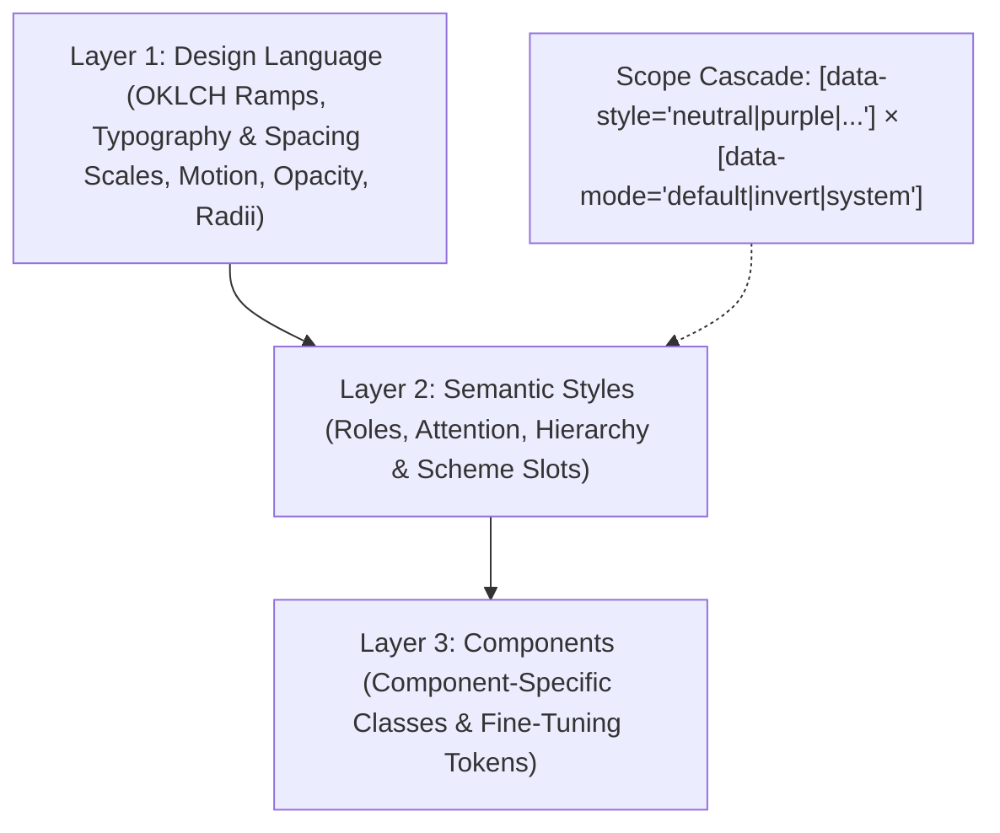

# AHHA Design Decisions, Architecture & Principles

This document records the foundational architectural decisions, visual principles, and component engineering standards established for the AHHA Design System and its codified component library (`@andiihei/ahha`).

---

## 1. Architectural Overview & System Layers

The AHHA Design System is built upon a deterministic three-tier hierarchy designed to keep components completely theme-, brand-, and polarity-agnostic:

### Layer 1: Design Language

Layer 1 encapsulates everything a theme needs to express itself—the complete design language foundation:

- **Color Families**: 6 distinct OKLCH families (`neutral`, `purple`, `green`, `red`, `yellow`, `blue`) across 11 discrete luminance steps (`1000..25`, omitting steps 400 and 600).
- **Fluid & Static Spacing**:
  - **Fluid Rhythm (`--space-10` to `--space-500`)**: Governed by the Utopia fluid interpolation engine (`progress()` / `@supports tan(atan2())`) scaling from 360px viewport @ 18px base up to 1240px viewport @ 20px base. Reserved exclusively for macro-layouts (page containers, sections, hero blocks).
  - **Static Rhythm (`--space-static-10` to `--space-static-500`)**: Anchored on a fixed 20px base. Reserved for micro-component internals (paddings, gaps, icons, border offsets) to prevent layout distortion on resizing.
- **Concentric Geometry (`radius.css`)**:
  - Inner corner radii follow the geometric law: $R_{inner} = \max(0, R_{outer} - \text{inset})$, preventing awkward gaps in nested boundaries.
- **State Layers & Dynamics (`opacity.css` & `motion.css`)**:
  - Hover states apply an ink layer at `--opacity-10` (10%).
  - Active/pressed states apply an ink layer at `--opacity-15` (15%).
  - Disabled states render at `--opacity-40` (40%) with pointer events suppressed.
  - Micro-interactions use `--duration-50` / `--ease-in-out`; layout shifts use `--duration-100` / `--ease-out`.

### Layer 2: Semantic Styles

Layer 2 translates raw design language primitives into functional intent, concerned with roles, attention, and visual hierarchy:

- **Hierarchy & Attention**: Translates contrast, optical weight, and color ramps into semantic roles (Headings, Paragraphs, Actions, Details) and emphasis levels.
- **Semantic Scheme Slots**: All UI elements bind to functional slot contracts rather than direct primitive tokens:
  - **Surfaces**: `--surface-bg`, `--surface-bg-1`, `--surface-border`
  - **Text / Ink**: `--text-fg-1` (high-emphasis headline/current ink), `--text-fg-2` (supporting ink)
  - **Actions**: `--action-bg-1`, `--action-fg-1`, `--action-border`
  - **Brand**: `--brand-ink`, `--brand-line`, `--brand-faint`
- **Decoupled Cascading**: Components never hardcode hex, rgb, or specific color family ramps. Theme flipping is achieved simply by toggling `[data-style]` and `[data-mode]` on any ancestor element.

### Layer 3: Components

Layer 3 contains the actual custom elements and UI patterns (`<ads-button>`, `<ads-selector-button>`, `<ads-nav-menu>`, `<ads-card>`), along with:

- **Component-Specific Tokens**: Scoped custom properties for fine-tuning geometry, internal layout, track insets, and knob travel (e.g. `--toggle-width`, `--button-height`).
- **Compositional Utilities**: Component-level recipe classes that consume Layer 2 semantic slots while maintaining internal state machines (hover, active, focus-visible, selected, disabled).

---

## 2. Accessibility & Perceptual Contrast: APCA Standard & Equivalent Facilitation

A deliberate design and technical decision was made regarding color contrast evaluation:

### Decision: APCA (Advanced Perceptual Contrast Algorithm) over Legacy WCAG 2.x AA

- **Limitations of WCAG 2.x Math**:
  - Legacy WCAG 2.x relative luminance (4.5:1 / 3:1) relies on a simplified flat mathematical formula developed in the CRT monitor era that does not account for human vision physiology, modern display technologies, spatial frequency (stroke weight, font size), or optical polarity effects (light-on-dark vs. dark-on-light).
  - As a result, automated evaluation engines (such as axe) frequently produce false positives—flagging comfortable, legible secondary text or tinted backgrounds as violations—while simultaneously permitting genuinely illegible combinations (such as thin yellow text on white).

### Regulatory & Standards Framework: Equivalent Facilitation

The adoption of APCA is grounded in accessibility law and standards provisions that permit alternative, superior methods:

1. **Revised Section 508 (§ E101.2 Equivalent Facilitation)**:
   - Under the federal Section 508 standards (36 CFR Part 1194, Appendix A § E101.2):
     > _"Nothing in these Revised 508 Standards shall be considered to prevent the use of designs, products, or technologies as alternatives to those provided in the Revised 508 Standards that result in substantially equivalent or greater accessibility and usability."_
   - Furthermore, Section 508 evaluates alternative solutions against its Chapter 3 **Functional Performance Criteria (FPC)**—measuring real-world human visual perception rather than rigid algorithmic adherence.
2. **Rehabilitation Act Context (Section 501 / Section 504 / Section 508)**:
   - Across federal accessibility mandates (including federal employment under Section 501 and technology access under Section 508), statutory frameworks explicitly recognize that rigid technical specifications must not penalize technologies that deliver equal or superior accessibility outcomes.
3. **W3C WCAG Conformance & The Path to WCAG 3.0**:
   - The W3C Silver / Accessibility Guidelines Working Group (AGWG) developed **APCA** specifically to replace the flawed WCAG 2.x contrast math for **WCAG 3.0**.
   - Conformance to APCA provides scientifically validated, perceptually accurate readability across font sizes, weights, and color contexts, thereby exceeding the real-world accessibility provided by legacy WCAG 2.x flat ratios.

### System Policy & Target Conformance Level

- **Target Conformance: APCA Bronze Level (WCAG 2.1 Level AA Equivalent)**: For this personal design portfolio, the governing standard is the **APCA Bronze Level** (conforming to WCAG 2.1 Level AA equivalent thresholds). Higher tiers (Silver/Gold or WCAG AAA) are intentionally not mandated: the Bronze level guarantees verified, comfortable perceptual readability while preserving visual subtlety, tinted surfaces, and expressive brand character.
- **APCA Bronze Thresholds Applied**:
  - **Body Text**: $L_c \ge 60\text{--}75$ (depending on font weight and size).
  - **Headings & Large Content**: $L_c \ge 45$.
  - **Interactive Controls, Borders & Icons**: $L_c \ge 30$.
  - **Incidental & Disabled Elements**: Exempted / permitted below $L_c 30$.
- The AHHA Design System formally adopts **APCA Bronze** as its governing readability standard under the **Equivalent Facilitation** provision (Section 508 § E101.2).
- Page links and supporting elements in navigation use `--color-300` / `--neutral-300` on light mode (`--page-dim`) and `--color-500` / `--neutral-500` on dark mode. This creates intentional visual hierarchy where the active page link (`--text-fg-1` with underline indicator) stands out distinctly without sacrificing reading comfort or perceptual clarity.
- Automated test suites (e.g., axe) flagging secondary link states under flat WCAG 2.x math are documented and excused under this equivalent facilitation principle.

---

## 3. Responsive Breakpoints & Viewport Boundaries

The AHHA Navigation Menu (`<ads-nav-menu>`) defines three distinct responsive tiers governed by container queries with viewport fallbacks:

| Tier Name                  | Code Variant | Width Range         | Layout Behavior                                                                                                                 |
| :------------------------- | :----------- | :------------------ | :------------------------------------------------------------------------------------------------------------------------------ |
| **Extra Compact (Mobile)** | `xCompact`   | **380px – 574px**   | Brand logo + Tabler glyph burger (`menu-3`) with expandable vertical drawer and mobile segmented mode switcher.                 |
| **Compact (Tablet)**       | `compact`    | **574px – 896px**   | Two-row layout: Full brand logo on Row 1 (safe space protected), page links and desktop Mode Switcher distributed across Row 2. |
| **Full (Desktop)**         | `full`       | **896px – 1400px+** | Single-row horizontal layout: Brand logo on the left, cluster with page links and Selector Button on the right.                 |

### Minimum Supported Viewport Hard Floor: 380px

- The system establishes **380px** as the absolute minimum supported viewport width.
- Sub-380px viewports (e.g. legacy 320px feature phones) are outside the design system target matrix.
- In Storybook interactive specimens, container sliders and wrapper elements enforce explicit `min-width` and `max-width` hard stops matching these exact thresholds.

---

## 4. Logo & Safe Space Protection Principles

The ANDII HEI logotype has specific preservation rules:

1. **Duotone Treatment**:
   - `ANDII` renders with `--brand-ink` (primary high-contrast ink).
   - `HEI` renders with `--brand-faint` (subtle secondary tint), preserving the mark's original typographic rhythm across both default and invert modes.
2. **Safe Space Isolation**:
   - At no point should page links or action controls crowd or clip into the brand logo.
   - When viewport/container width drops below **896px**, the layout immediately breaks into two dedicated rows (`Compact`) rather than wrapping arbitrarily into broken horizontal clusters.
   - When container width drops below **574px**, links collapse into the off-canvas drawer (`xCompact`).

---

## 5. Web Component Authoring Standards

All enterprise custom elements in `src/components/` adhere to the following codified conventions:

1. **Light DOM Custom Elements (`createRenderRoot() { return this; }`)**:
   - Components render directly into the Light DOM, enabling the AHHA design language tokens, CSS cascade, and CSS Container Queries to flow naturally without Shadow DOM styling boundaries.
2. **Standard Sizing Scale**:
   - Interactive components (`ads-button`, `ads-selector-button`, `ads-toggle`) conform to `sm`, `md` (default), and `lg` sizing scales with standardized static paddings.
3. **Label in Name Accessibility (WCAG 2.1 SC 2.5.3)**:
   - All interactive controls with visible text must include that exact text in their programmatic accessible name. Decorative glyphs (chevrons, icons) carry `aria-hidden="true"`.
4. **Autonomous Testing & Storybook Verification**:
   - Every component has a dedicated Storybook story file covering all variants, responsive containers, and color family schemes.

---

## 6. Task Planning & Effort Level Heuristic

To maintain architectural integrity across the design system while moving quickly on tactical updates, all tasks are evaluated against an effort level heuristic with an upfront declaration:

|   Level    | Scope                                    | Trigger Scenarios                                                                                                                  | Verification & Protocol                                                                                                          |
| :--------: | :--------------------------------------- | :--------------------------------------------------------------------------------------------------------------------------------- | :------------------------------------------------------------------------------------------------------------------------------- |
|  **Low**   | **Tactical & Localized**                 | Isolated CSS tweaks, inspector formatting, typo/copy edits, minor story updates                                                    | Direct targeted edit, Storybook visual verification, clean git commit                                                            |
| **Medium** | **Component & Feature Expansion**        | Authoring new Web Components, adding Storybook stories with Vitest interaction tests, tooling configs                              | Light DOM adherence, APCA contrast validation, WCAG 2.1 SC 2.5.3 Label in Name conformance, 100% test pass                       |
|  **High**  | **Architectural & Multi-Layer Systemic** | Layer 1 OKLCH/Utopia scale changes, Layer 2 semantic slot refactors, global container breakpoint shifts, contrast standard changes | Cross-file impact analysis across all specimen pages, dual light/invert verification, documentation update, full test suite pass |
